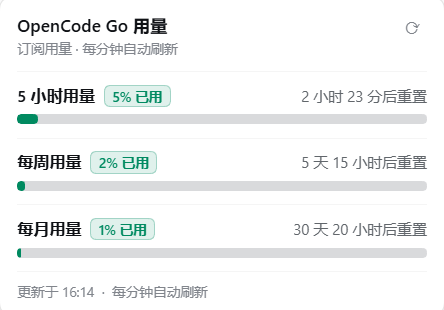

# dsh-opencode-go-usage

在 DeepSeek Harness 左侧栏放一个「OpenCode Go 用量」入口，点击弹出悬浮窗查看 **5 小时 / 每周 / 每月**已用百分比与重置倒计时，样式对齐 OpenCode 官方控制台。



## 功能

- **左侧栏入口**：出现在「自动化任务」下方、「工作区」上方，和「插件」「自动化任务」同一列表；收起侧栏时只显示图标。
- **点击弹悬浮窗**：悬浮窗紧贴入口右侧弹出，不切换主视图；点击窗外、按 `Esc` 或再点入口即可关闭。
- **官方数据源**：直接读取 OpenCode Go 网关的 `GET {baseURL}/usage`，与官方控制台同一份数据（`rolling` / `weekly` / `monthly` 的 `percent` 与 `resetsAt`）。
- **重置倒计时**：每秒刷新，显示「2 小时 23 分后重置」，悬停可看绝对时间。
- **自动刷新**：每分钟查询一次；页面切到后台时暂停，回到前台立即刷新；也可以点标题栏的刷新按钮手动拉取。
- **主题跟随**：颜色使用 DSH 的 `--dsw-alias-*` 设计令牌，明暗主题都能融入。
- **密钥不出宿主**：API Key 只在 DSH 宿主进程里读取并用于请求，浏览器只拿到百分比与时间。
- **兼容旧布局**：仍注册着右侧栏的同名页面，之前保存过该标签页的布局不会坏。

## 安装

```powershell
dsh plugin --profile desktop add link:D:\QWQ\Code\dsh-plugin-opencode
```

命令会把包加入 profile 的依赖与 `dsh.profile.bundles`，宿主随即组合该 bundle 的 patch 并热加载客户端代码。装好后左侧栏就会出现「OpenCode Go 用量」。

卸载：`dsh plugin --profile desktop remove dsh-opencode-go-usage`。

## 配置

默认读取 DSH 凭据里的 `OPENCODE_GO_API_KEY`（回退 `OPENCODE_API_KEY`），网关地址为 `https://opencode.ai/inference/go/v1`。需要覆盖时，在 profile 的 `cordis.patch.yml` 中给该行加 `config`：

```yaml
- id: opencode-go-usage
  name: dsh-opencode-go-usage
  config:
    apiKeyEnv: OPENCODE_GO_API_KEY
    baseURL: https://opencode.ai/inference/go/v1
    cacheMs: 20000
    timeoutMs: 8000
    route: /dsh-opencode-go-usage/usage.json
```

| 字段 | 默认值 | 说明 |
| --- | --- | --- |
| `apiKeyEnv` | `OPENCODE_GO_API_KEY` | 读取的凭据名；也可传 `apiKeyEnvs: [a, b]` 依次尝试 |
| `baseURL` | `https://opencode.ai/inference/go/v1` | 网关根地址，插件请求 `${baseURL}/usage` |
| `cacheMs` | `20000` | 宿主缓存时长，避免频繁请求 |
| `timeoutMs` | `8000` | 单次请求超时 |
| `route` | `/dsh-opencode-go-usage/usage.json` | 浏览器读取用的同源只读路由 |

## 实现

- `index.js`（宿主）：解析配置 → 从 `ctx.credentials` 取 Key → 请求网关 `/usage` → 校验并裁剪响应 → 通过 `ctx.webServer.register` 暴露只读同源路由；跨站与跨源请求直接 403，响应不含密钥。
- `client.js`（浏览器）：
  - `sidebar.panellist` 注册左侧栏入口（`id: opencode-go-usage`，`order: 20`）；
  - `main` 注册同名占位页：侧栏行由侧栏统一 `selectPanel(id)` 打开，占位页挂载后立即 `selectPanel(上一页)` 还原，并打开悬浮窗；点图标时则直接开窗、不触发切换；
  - `shell.overlay` 注册悬浮窗，位置取自点击元素，`Esc`/点击外部关闭；
  - 文字经 `ctx.locale.register('opencode-go-usage', { zh, en })` 注册，跟随 DSH 语言切换。
- 悬浮窗开关状态存在 `window.__dshOpencodeGoUsageOverlay`，避免客户端 bundle 被多次实例化时状态对不上。

## 数据与限制

网关 `/usage` 返回的是**百分比**（0–100）与各自的重置时间，不包含美元额度；面板因此与官方控制台的百分比一致，但不会显示「已用 $x / 限额 $y」。额度窗口按模型计价，具体金额以 OpenCode 控制台为准。

## 验证

- 宿主路由：`curl http://127.0.0.1:10624/dsh-opencode-go-usage/usage.json` 返回 `{ ok: true, usage: { rolling, weekly, monthly } }`。
- 界面：左侧栏出现「OpenCode Go 用量」；点击后悬浮窗显示三个窗口的百分比与倒计时；`Esc` 与点击窗外可关闭；刷新按钮与每分钟轮询生效。
- 未配置 Key 时面板显示「未配置 OpenCode Go API Key（OPENCODE_GO_API_KEY）」。

## 许可

MIT
